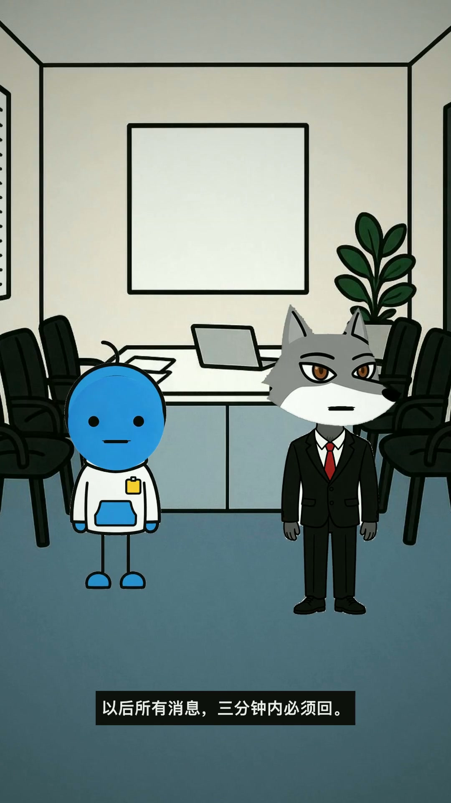
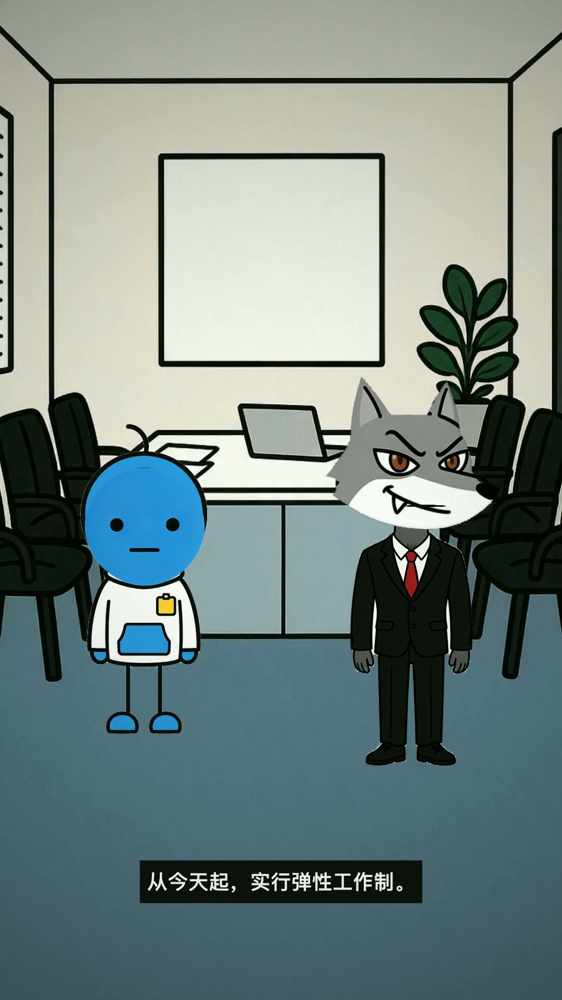
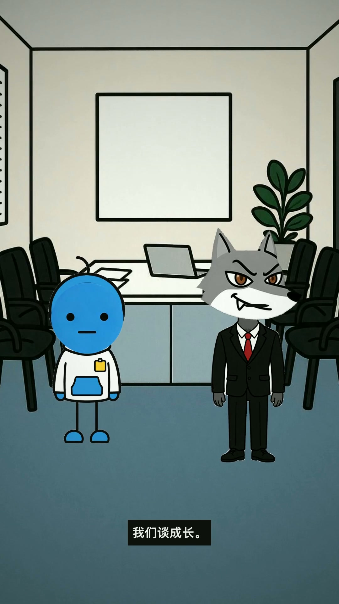

# 沙雕漫剧 · shadiao-manju

把一句话、一个段子、一章小说，做成 1–2 分钟的竖屏沙雕动画。

跑在本地开源的「沙雕动画小助手」Web 社区版上。剧本、配音、素材、工程全部由脚本串起来，人只在浏览器里点两下：预览，导出。

```
一句话 / 段子 / 小说 / 热点
  → 01 剧本      音频优先 + 沙雕喜剧机制 + 三秒钩子
  → 02 配音      一角色一音色，逐句合成 + 时长表
  → 03 素材      火柴人 / 熊猫头，整身 + 8 表情
  → 04 工程      三份 JSON → 可打开的 .anime
  → 05 出片      浏览器导出 + ffmpeg 混音 / 字幕 / 结尾卡
  → 06 质检      上线检查单
```

<table>
  <tr>
    <td></td>
    <td></td>
    <td></td>
  </tr>
  <tr>
    <td align="center">第01集《已读》</td>
    <td align="center">第02集《弹性》</td>
    <td align="center">第03集《成长》</td>
  </tr>
</table>

## 它解决什么问题

沙雕短片的难点不在画。画一根火柴人不难，难的是：

- 台词删掉画面提示后，还能不能听懂
- 一集四十多秒，笑点够不够密，结尾收不收得住
- 二十多句台词，音频、字幕、表情、走位怎么对齐
- 改一句台词，要不要把整条时间线重搭一遍

这套流程的做法，是把每一步的产物固定成文件，下游只读上游：

| 产物 | 内容 |
|---|---|
| `01-剧本/剧本.json` | 谁在第几场说了什么、什么情绪、配什么音效 |
| `02-配音/第NN集/配音表.json` | 每句的 mp3、时长（毫秒）、音色、hash |
| `03-素材/素材索引.json` | 角色、表情、背景、道具的路径与对齐参数 |
| `04-工程/<剧名>.anime` | app 能直接打开的工程文件 |

改一句台词，只重跑配音和工程；换一个表情，只重跑工程。不会牵一发动全身。

## 快速开始

需要 Node 18+、Python 3.9+、ffmpeg，以及 Chrome / Edge（Safari 打不开本地项目文件夹）。

```bash
git clone https://github.com/kongzichixiangjiao/shadiao-manju.git
cd shadiao-manju

# 1) 装「沙雕动画小助手」并启动（一次性，约 1–3 分钟）
bash 00-工作台/setup_app.sh install
bash 00-工作台/setup_app.sh start

# 2) 竖屏补丁：原版只支持 16:9，导出 1080×1920 必须先打
bash 00-工作台/patch_vertical.sh apply

# 3) 新建项目
bash 00-工作台/new_project.sh 我的第一部沙雕剧
```

然后对 agent 说一句：

> 做一集沙雕漫剧，主题是「周一早上的打工人」。

它会按立项 → 剧本 → 配音 → 素材 → 工程 → 出片 → 质检的顺序往下走，每一步的产物落在 `99-项目/<剧名>/第NN季/`。

详细流程和命令见 [`SKILL.md`](SKILL.md)。

## 密钥与隐私

**仓库里不含任何密钥。** 需要生图时，用环境变量或本地 `.env`：

```bash
cp .env.example .env
# 填入 ARK_API_KEY（火山方舟 Seedream）
```

- `.env` 已在 `.gitignore` 中，不会被提交
- `ARK_API_KEY` 是可选项：不填就跳过 AI 生图，自己准备素材
- IndexTTS 克隆引擎需要额外工具链，用 `SHADIAO_TOOLCHAIN` 指过去；不用就留空，草稿音走 edge-tts
- 声音不克隆可识别真人；素材不盗用；对外发布标 AI 生成

## 目录

| 目录 | 干什么 |
|---|---|
| `00-工作台/` | 装 app、启动、自检、版本锁定、立项/设定模板 |
| `01-剧本/` | 喜剧机制、三秒钩子、音频优先、平台红线、剧本校验 |
| `02-配音/` | 角色→音色分配、逐句配音、时长表 |
| `03-素材/` | 画风规范、角色整身 + 表情、背景/道具 prompt、生图脚本 |
| `04-工程/` | 剧本 + 配音 + 素材 → `.anime`，含结构校验 |
| `05-出片/` | app 操作 SOP + ffmpeg 混音 / 字幕 / 结尾卡 |
| `06-质检/` | 上线检查单 |
| `99-项目/` | 一剧一根目录，所有产物只落这里 |

每个子目录下都有一份自己的 `SKILL.md`，写清楚输入、输出、质量门和常见坑。

## 示例项目

`99-项目/示例-周一打工人/` 是三集已跑通的样片：2 个角色、1 间会议室、每集 25 句左右，47.3 / 47.7 / 48.1 秒。

- 《已读》：消息三分钟内必须回
- 《弹性》：什么时候干完什么时候走
- 《成长》：开会只谈成长，不谈工资

仓库保留了剧本、配音表、角色素材、音效和成片封面；`05-成片/*.mp4` 不随仓库分发，避免把 Git 仓库撑大。要看成片，按下面的命令自己导一遍。

`.anime` 也没有入库——它是生成物，用 04 的命令现场生成。

## 已验证

| 项 | 状态 |
|---|---|
| app 安装与启动（Apple Silicon） | ✅ |
| `.anime` 被 app 真实加载 | ✅ |
| 20+ 块 TTS 音频路径与 `generatedFrom` 一致 | ✅ |
| 8 表情资源与 `set_material` 切表情 | ✅ |
| 说话嘴动（`talk`，跟着 TTS 有声片段） | ✅ |
| 待机呼吸、道具摆位、镜头跟随 | ✅ |
| app 内预览与导出 1080×1920 | ✅ |
| 9:16 竖屏补丁 | ✅ |
| IndexTTS 克隆实跑 | ⚠️ 只做了 dry-run，模型加载和合成较慢，建议挂过夜 |

## 不适合谁

- 想要 3D、精细手绘作画：这套是火柴人 / 熊猫头路线
- 想完全无人值守批量出片：浏览器端导出必须人工点
- 想做长剧、复杂运镜：这是 1–2 分钟的短视频流程

## 许可与致谢

- 本仓库代码与文档：MIT-0
- 「沙雕动画小助手」Web 社区版：[wormsun/FunnyAnimationAssitant](https://github.com/wormsun/FunnyAnimationAssitant)，Apache-2.0
- 示例素材由 AI 生成（Seedream），仅用于演示
- 音色默认只做听感参考，不提供可识别真人的克隆样本
